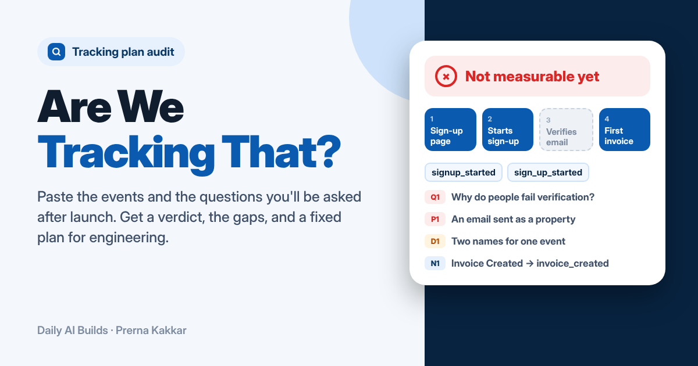

# Are We Tracking That?

**Can your tracking plan answer the questions you will be asked after launch? Paste the events, list the funnel steps and the questions. Printed rules check the plan for personal data, tool limits, duplicate names and missing failure events. A model maps each question and step to events, and every event and property it names is checked against your plan. You get a verdict, a fix list worst first, and a fixed plan as a CSV to hand to engineering.**

[Live app](https://are-we-tracking-that.vercel.app) · Three worked examples run without a key



---

## The problem

The tracking plan is usually written in the last week before a launch, by whoever has time, as a list of events. Nobody reads it against the questions the team will ask a month later. Then someone asks where people drop before verifying their email, and the answer is that nothing fires when verification fails, the sign-up start is split across two event names, and the one property that says where people came from sits on an anonymous page view that never joins to the account.

Each of those is cheap to fix before engineering builds the events and expensive after, because the data you did not collect is gone. The PM is the person who knows the questions, so the PM is the person who should check the plan. Most PMs do it by eye, if at all.

## How I got here

This build came out of the two before it. Front Door finds where a sign-up flow loses people and Then What? finds where new users stall before their first win. Both start from a set of numbers and assume the events behind them exist and mean what their names say. Their worked examples use clean, invented funnels, and real ones are rarely that clean. The first question an analyst sends back about a drop-off chart is whether the events can be trusted.

Tracking Plan Audit had been on the shortlist for this run for a while, and I kept picking other builds over it. It moved up once Front Door and Then What? existed, because it is the step that has to happen before either of them is worth running.

The first version I scoped was a linter: read the event list, flag bad names, duplicates and personal data. That part needs no model and it is useful, but it checks the plan against itself. A plan can be perfectly named and still unable to answer the one question the launch review will ask. So the audit starts from your questions and your funnel steps, and the naming rules sit underneath as tidy-ups that never change the verdict on their own.

## What it does

| | |
| --- | --- |
| **Your plan** | The product, the flow, the analytics tool, your naming convention, how users are identified, the funnel steps, the questions and the plan itself, pasted as `event \| properties \| when it fires`, as rows from a sheet or as CSV. A read-back table shows how each line was split, and a live check reruns the rules as you type |
| **Verdict** | Ready to measure, Measurable with gaps, or Not measurable yet, with how many questions are answerable, how many steps are covered, the funnel at a glance and every rule that fired |
| **Questions** | Each question with the events behind it, the properties it needs (present or missing), what is missing in a sentence, and a note when the check lowered the model's answer |
| **Funnel** | Each step, covered or not, with its events |
| **Fix list** | Events to add, events to rename, merge or change, then every finding by severity. The fixed plan downloads as a CSV, and the audit copies as Markdown for a ticket |

## The design choice that matters

**The model maps. Rules decide.** Matching "why do people fail email verification?" to events needs reading: `email_verified` looks relevant, but its description says it fires when the link is opened, which proves nothing about success. That is a job for a model. Deciding whether the plan is ready should not be: the same plan should get the same verdict every time, and a PM should be able to read why.

So the model never gives the verdict. It returns tagged lines: which events mark each step, whether each question can be answered and with which events and properties, and what to add. Then three checks run in the browser:

1. **Names must exist.** An event the model names counts only if it is in your plan. Anything else is dropped and listed.
2. **Properties must be on the events.** If a question needs `utm_source`, one of the events cited for it must carry `utm_source`.
3. **The check only lowers.** The final answer for a question is the lower of the model's and the check's. A model that says yes on events that do not exist gets a no.

The plan rules (personal data, GA4 limits, failure events, identity, source, duplicates and naming) run with no model at all, so the app is useful before you map anything.

This is the same split as Send or Hold?, Wrong Turn and Who Does What? in this repo: the model describes, the rules decide.

## The rules

| Rule | Severity | What it checks |
| --- | --- | --- |
| **R1 to R3** | | Model names must be in the plan, needed properties must be on a cited event, and the check can only lower an answer |
| **S1** | Blocker | A funnel step with no event behind it |
| **Q1** | Blocker | A question with no event that answers it |
| **Q2** | Gap | A question answered only in part |
| **P1** | Blocker | A property that looks like personal data: email, phone, name, address, IP, ID numbers, card or bank details |
| **G1 to G3** | Blocker | GA4 only: names over 40 characters, more than 25 parameters on an event, reserved names or prefixes, or characters GA4 does not accept |
| **F1** | Gap | A flow where people can fail, with start or submit events but no failure event anywhere |
| **F2** | Gap | A failure event with no reason or error property |
| **I1** | Gap | You are not sure how users are identified |
| **I2** | Gap | Visitors start anonymous but nothing marks when they become a known user |
| **A1** | Gap | A sign-up or booking flow with no source, UTM, campaign or referrer property |
| **D1** | Gap | Two events that mean the same thing under different names, such as `signup_started` and `sign_up_started` |
| **N1 to N4** | Tidy | Names off your convention, vague events like `button_clicked`, events with no description of when they fire, and events listed twice |
| **V** | | Any blocker means Not measurable yet. Gaps only means Measurable, with gaps. Tidy-ups never change the verdict |

## Worked examples

All three products and plans are invented. Each has a saved model map, so it opens without a key, and the rules run live.

| Example | What it shows | Verdict |
| --- | --- | --- |
| **Invoicing app sign-up** (Amplitude) | Two names for one sign-up event, an email sent as a property, nothing firing when verification fails, and a source that sits on an anonymous page view | Not measurable yet |
| **Grocery app checkout** (Mixpanel) | Clean Title Case names and full coverage, but payment failures carry no reason, so a declined card looks the same as a timeout | Measurable, with gaps |
| **Holiday rental direct booking** (GA4) | One event name too long for GA4, guest email and phone sent as properties, and no event for opening the cancellation policy | Not measurable yet |

## How it is built

- **React and Vite**, one page, with a fixed left sidebar and icons from Lucide.
- **One serverless function**, `api/audit.js`, holds the prompt and the key, so neither reaches the browser.
- **Muse Glimmer by default**, through NVIDIA's free endpoint on my key. Visitors can switch to Anthropic, OpenAI or Gemini with their own key, used for one request and never stored.
- **Tagged lines, not JSON.** The model replies in lines like `Q|3|no|NONE|NONE|Nothing fires when verification fails`. A broken line is skipped and the rest still counts.
- **All verdict logic in `src/rules.js`**, the same file the How it works page prints from.

## Run it locally

```bash
cd are-we-tracking-that
npm install
npx vercel dev   # runs the app and the API function together
```

Set these in Vercel or a local `.env.local`:

| Variable | Value |
| --- | --- |
| `LLM_BASE_URL` | `https://integrate.api.nvidia.com/v1` |
| `LLM_MODEL` | The Muse Glimmer model id on NVIDIA |
| `LLM_API_KEY` | Your NVIDIA API key |

## What it cannot do

It reads the plan, not your tool. It cannot see what is actually firing in production, so a plan that passes here can still be built wrong; a QA pass against live events is a separate job. The personal data rule matches property names, so a field called `contact` holding an email will slip through. The GA4 limits are the ones Google publishes for collection; other tools have their own and only GA4's are checked. The model can still map a question to the wrong event that does exist in the plan, and the check cannot catch that, which is why each mapping is shown with its events for you to read.

## What I would test next

Nobody outside me has used it yet, so the rules are still my judgement rather than evidence.

The test I would run is with a PM and the analyst who supports them, on a real plan from a launch that has already happened. The analyst lists the questions they were actually asked in the month after launch and marks which ones the data could answer. Then the PM runs the plan as it was before launch through the app, with the same questions.

- **Did the verdict predict the pain?** If the questions the analyst could not answer are the ones the app marked No or Partly, the question-first approach works. If the app passed them, the mapping is too generous.
- **Which rules the analyst cares about.** I expect the failure-event and identity rules to matter more than naming. If the analyst says naming drift cost them the most time, N1 should be a gap rather than a tidy-up.
- **Whether the CSV gets used.** If the PM pastes the fixed plan back into their sheet, the export is the product. If they only read the fix list, the CSV can go.

---

Built by [Prerna Kakkar](https://github.com/kakkarprerna) as part of [Daily AI Builds](../). I set the brief, the rules and the guardrails, and reviewed every version. The code was written by AI coding tools from my prompts and review.
