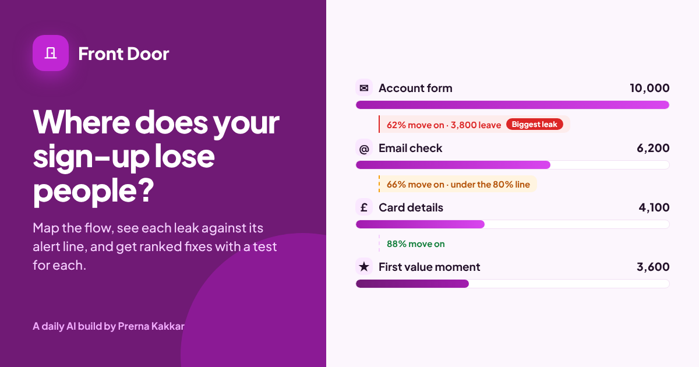

# Front Door

**Find where your SaaS sign-up and sign-in flow loses people, and what to fix first. Map the steps from the sign-up button to the first moment the product works for someone, add counts if you have them, and paste what you know: screen copy, tickets, interview notes. Printed rules find the leaks, rank every fix and pair each one with a test, the number that decides it and the number to watch. A model reads your notes and points at the moments people struggle, quoting your words.**

[Live app](https://front-door-signup.vercel.app) · Three worked examples run without a key



---

## The problem

Most sign-up reviews start with a screenshot tour and end with a list of opinions. Someone wants fewer fields, someone wants a product tour, someone wants the card up front because it filters out tyre-kickers. Nobody can say which change matters most, because nobody has put the steps, the counts and the complaints side by side.

The people who leave are also the ones you never hear from. Support hears from the few who wrote in about the email that never arrived. The funnel shows a drop after the account form. Interview notes say the lead wanted to try it alone first. Those three facts are about the same flow, and they usually live in three different places.

Running onboarding alongside product at Ylytic and Jinn Live taught me to look at the path to first value as one thing, from the first click to the first moment the product does its job, and to treat the way back in for returning people as part of it. Front Door puts that path on one page and says what to fix first.

## How I got here

Sign-up is where most users drop off, and the cause is often something basic: the screens, the landing page, or a forgotten-password flow that doesn't work. At both Ylytic and Jinn Live there were times our sign-up flow was broken. Reset links failed. Reset and confirmation emails sometimes landed in spam. In some cases the forgot-password flow created a new user in the database instead of resetting the existing one, so the person ended up with a second, empty account and none of their work. None of these were hard product problems. They were the basic requirements of a product, and they still cost us users who never got as far as seeing what it did.

So I built this one for the basics, so they get checked as a whole flow before they lose anyone. That is why the way back in sits beside the way in. A returning user who can't reset a password is lost just as surely as a new one who never confirms their email, so rule S1 rates email and password sign-in with no self-serve reset as High.

Front Door was the first of a pair. Once the way in was mapped, the next question was what happens between having an account and getting value from it, which became [Then What?](../then-what).

## What it does

| | |
| --- | --- |
| **Map the flow** | The product, who signs up, how they start (free plan, trial with or without a card, demo first), each step in order with whether it can be skipped, how many fields it asks for and how many people reach it, how returning people sign in, and your notes |
| **Where they leave** | The verdict, the share who reach first value, the biggest leak, and a step-by-step funnel showing who moves on at each step against that step's alert line |
| **Friction found** | Every finding, ranked, filtered by phase (signing up, getting to value, coming back), each with the rule or the quote behind it. Hide any finding that does not apply and the verdict updates |
| **Fix plan** | For each finding, the fix, the change to test, the number that says whether it worked and the number to watch so the fix does not break something else, plus questions to check in your data first |
| **Report** | A Markdown review with the verdict, the flow and its counts, every fix in order and the questions, ready for an email, Notion, Confluence or a ticket |

## The design choice that matters

**Rules decide. A model reads.** The same flow should get the same verdict every time, so every finding, score, ranking, fix and test comes from printed rules in `src/rules.js`. The model never sets any of them.

What the model does is the part rules cannot: read a page of support tickets, screen copy and interview notes and point at the moments people get stuck. "The confirmation email went to spam or never arrived" is a sentence a rule cannot find. A model can, and it has to quote it.

Every moment is checked before it counts. The quote has to appear in your notes word for word, the kind has to be one on the printed list, and the kind sets the severity, not the model. When a moment lands on a step a rule already flags, it joins that finding as evidence instead of becoming a duplicate (rule M4), so the fix plan carries the specific fix for the step rather than a generic one. An error or dead end always stands on its own, because it needs its own fix.

This is the same split as Riskiest Bet First, Ready to Go Live? and Who Does What? in this repo.

## The rules

| Rule | What it does |
| --- | --- |
| **L1** | For each step with a count, kept = people at the next step ÷ people at this step |
| **L2** | A step leaks when kept falls under its alert line. The step losing the most people is the biggest leak |
| **L3** | Counts are optional. Without them the findings still stand, ranked on severity alone |
| **L4** | A leaking step that no rule or note explains becomes an Unexplained drop, with a fix of finding the cause before changing anything |
| **F1** | Card details before first value, or a trial that takes the card up front: High |
| **F2** | A required email check before first value: High |
| **F3** | A required phone or SMS check before first value: High |
| **F4** | Account form with more than 4 fields: Medium. More than 7: High |
| **F5** | More than 3 required onboarding questions before first value: Medium |
| **F6** | Inviting teammates required before first value: High |
| **F7** | Connecting a real system required before first value: High |
| **F8** | No first value step in the flow: High |
| **F9** | More than 5 steps before first value: Medium. More than 7: High |
| **F10** | A required plan choice before value when the start is free: Medium |
| **F11** | A product tour that cannot be skipped: Low |
| **F12** | Teams or enterprise trial with no Google, Microsoft or SSO sign-in: Medium |
| **F13** | A required password step before value: Low |
| **S1** | Email and password sign-in with no self-serve reset: High |
| **S2** | A code at every sign-in with no remembered device: Medium |
| **S3** | Password as the only way back in: Low |
| **M1** | A model moment counts only if its quote is in your notes, word for word |
| **M2** | Its kind must be on the printed list. Its step number must exist, or it is tied to no step. Step 0 means coming back to sign in |
| **M3** | The kind sets the severity: Blocks the way and Error or dead end are High; Asks too much, Trust worry and Sign-in trouble are Medium; Unclear wording is Low |
| **M4** | A moment on a step a rule already flags, or a sign-in moment when an S rule already fires, joins that finding as evidence and keeps the higher severity. An error or dead end always stands on its own |
| **R1** | Score = severity (High 3, Medium 2, Low 1) × 2, plus 2 if its step leaks, plus 1 if it is the biggest leak, plus 1 if your notes show it happening |
| **R2** | Rank by score, then signing up before getting to value before coming back, then step order |
| **R3** | You can hide a finding. It leaves the ranking and the verdict and stays listed as hidden |
| **V1** | Any High finding on the way to value: **Unblock the path to value** |
| **V2** | No High on the way in, but a High on the way back: **Fix the way back in** |
| **V3** | Medium findings only: **Smooth the rough steps** |
| **V4** | Low findings or none: **Measure and tune** |
| **A1** | A step type you type yourself uses a 75% alert line and triggers no F rule, only leaks and model moments |
| **A2** | You can set your own alert line for any step |

## Alert lines

Flag a step when fewer than this share of the people who reach it move on.

| Step | Line | Step | Line |
| --- | --- | --- | --- |
| Sign-up button | 40% | Account form | 70% |
| Google or Microsoft sign-up | 85% | Company SSO | 80% |
| Set a password | 85% | Email check | 80% |
| Phone or SMS check | 80% | Onboarding questions | 80% |
| Workspace setup | 85% | Choose a plan | 80% |
| Card details | 50% | Invite teammates | 75% |
| Connect data or an app | 70% | Create an API key | 85% |
| Product tour | 85% | Your own type | 75% |

**These are starting points I set, not published benchmarks.** Your own history is a better line, and every step lets you change it.

## The worked examples

All three products are invented and their counts are illustrative.

| Example | The flow | Verdict |
| --- | --- | --- |
| **Ledgerly**, invoicing for freelancers | Seven-field form, an email check with no resend, a card for a free trial, five questions, then a bank connection that times out. About one in nine people who start send an invoice | Unblock the path to value |
| **Standup Loop**, async standups for teams | Google sign-up, then an invite screen with a skip link people miss. Returning users get a code every time, with no reset and no recovery | Fix the way back in |
| **Fieldnote API**, a developer API | A short, clean sign-up. The leak sits between creating a key and the first call, where the quickstart asks for a full setup | Smooth the rough steps |

## What it cannot do

It sees only the steps, counts and notes you give it. It cannot see your screens, so a problem nobody wrote down stays invisible unless it shows up as a leak. Counts pulled from different tools or date ranges can make a step look worse than it is. It does not run the tests, and a fix that wins in one segment can lose in another.

The flow starts at the sign-up button, so the landing page sits just outside it. A landing page that turns people away shows up only as fewer people reaching the first step, not as a finding of its own.

## What I would test next

The three worked examples are invented. The real test is a team whose sign-up flow has broken before, the way ours did, running their current flow through it.

- **Would it have caught the break?** I would ask them to describe the flow as it was when it broke, and see whether Front Door puts that step at the top. I already know one gap from my own cases. Rule S1 fires when there is no self-serve reset, but a reset that exists and fails, or one that quietly creates a duplicate account, is only caught if a ticket or note says so and the model quotes it. If those breaks keep getting missed, the way back in needs its own steps and counts, the same as the way in.
- **Do the basics rank high enough?** A missing password reset or a confirmation email that never arrives can look minor next to a long form. If teams keep moving those findings up, the severities are too low.
- **Does the landing page need to be in the flow?** If most teams say the drop starts before the sign-up button, the next version should take the landing page as step zero.

## Models and keys

The model call runs in a serverless function (`api/read.js`), so the prompt and key never reach the browser. By default it uses Meta Muse Glimmer on NVIDIA's free endpoint. Visitors can switch to Anthropic, OpenAI or Gemini with their own key, which is sent once with that request and never stored. Replies come back as tagged lines (`MOMENT|2|Blocks the way|...`), so a broken line is skipped rather than breaking the result.

Everything else, including the funnel, the findings, the ranking, the verdict and the fix plan, runs in the browser with no key.

## Run it locally

```bash
cd front-door
npm install
npx vercel dev
```

| Variable | Value |
| --- | --- |
| `LLM_BASE_URL` | `https://integrate.api.nvidia.com/v1` |
| `LLM_MODEL` | The Muse Glimmer model id on NVIDIA |
| `LLM_API_KEY` | Your NVIDIA API key |

## Built with

React, Vite and lucide icons, deployed on Vercel. Part of [Daily AI Builds](../). Brief, product and design calls, guardrails and review by Prerna Kakkar. Code written by AI coding tools from her prompts and review.
