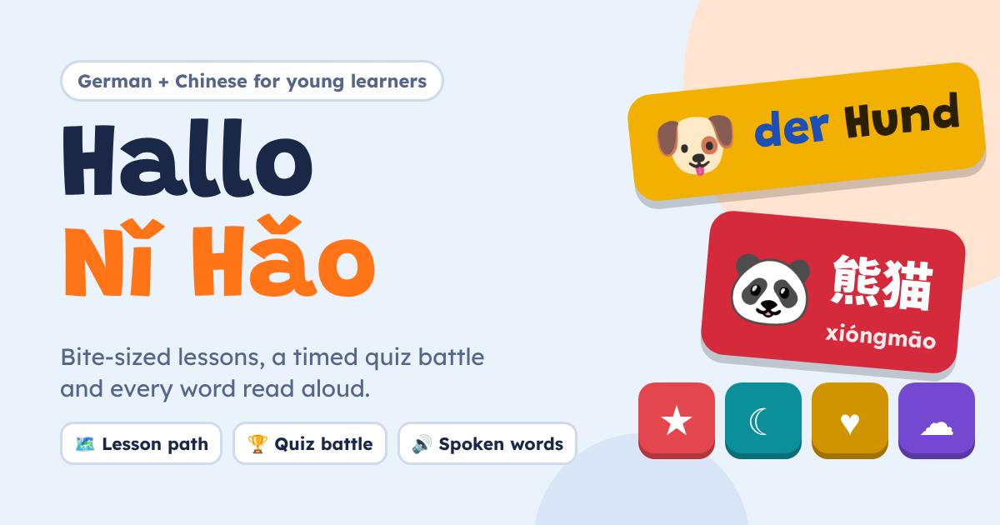

# Hallo Nǐ Hǎo

A practice app for children starting German and Chinese at school. Short lessons on a path, a timed quiz battle, and every word read aloud.

Live: https://hallo-nihao.vercel.app



## The problem

My son is eight and started German and Chinese in the same school year, both from zero. Two new languages at once means two sets of homework words, one of them in a new writing system with tones. Children his age practise far more willingly when it feels like a game: short rounds, a score, and a record to beat.

The big language apps are built for adults choosing one language. They don't follow a school's topics, they nudge towards a subscription, and switching between two languages a child is learning side by side is clumsy. I wanted one small place where he can do five minutes of German, then five minutes of Chinese, on the words his class is actually covering.

## What it does

| | |
| --- | --- |
| 🗺️ **Learn** | Six units per language: greetings, numbers, colours, animals, family and food. Each lesson is eight quick questions, with three hearts and up to three stars per unit. Finishing a unit opens the next one. |
| 🏆 **Quiz Battle** | Ten questions against a 20-second clock, with four coloured answer tiles. Faster answers score more, answers in a row add a bonus, and a podium shows the top three scores. |
| 📖 **Words** | Every word with its picture, meaning and a speaker button. This is the homework checker. |
| ℹ️ **For grown-ups** | A short sheet explaining how it works and what it stores. |

Question types in a lesson:

- 🖼️ **Pick the picture.** The word is shown and spoken, and the child chooses the matching picture.
- 💬 **Say it.** A picture and its English meaning, with four words to choose from.
- 👂 **Listen.** The word is only spoken, and the child picks what they heard.
- 🧩 **Match the pairs.** Four words against four pictures.
- 🔵🔴🟢 **der, die or das?** German only. Picks the article for a noun.
- 🀄 **Read it.** Chinese only. A character on its own, with four pinyin readings to choose from.

## Product decisions

**Built around each language's hard part.** For German, that is the article. Every noun is shown with *der*, *die* or *das* in blue, red or green, the colour convention many German teachers use, and there is a question type just for choosing it. For Chinese, it is tones and reading characters. Pinyin always shows tone marks, there is a "read it" question with the character on its own, and the Words tab carries a tone key.

**Mistakes come back, hearts run out.** A missed question returns once at the end of the lesson with its options reshuffled, so the last thing a child does is get it right. Three hearts make a lesson feel like a game rather than a worksheet. Running out ends the round with an encouraging message and a retry, never a penalty that carries over.

**Two motivation loops for two moods.** The lesson path is calm and rewards finishing: stars, XP and a day streak. The quiz battle is loud and rewards speed: a countdown, a draining timer bar and a podium. A child can pick whichever suits the mood that evening.

**The child competes against themselves.** The podium holds their own best scores, not other children's. There are no accounts and no leaderboard of strangers, so there is nothing to sign up for and no one to compare with.

**No model, no network, no sign-in.** Every word is written into the app and every rule is fixed, so nothing is generated on the fly. A child learning first words should never see a made-up translation, so a model was the wrong tool. Progress is saved only in that browser's local storage.

**Device voices, with a graceful gap.** Words are spoken by the browser's built-in speech voices, slowed down a little. Most phones and laptops have German and Chinese voices. Where a device has none for a language, listening questions are left out for it and everything else still works.

**Wrong options from the same topic.** In the quiz, the three wrong answers always come from the same unit as the right one. A number is never up against an animal, so the answer can't be guessed from the picture type.

## Scoring

| Rule | Value |
| --- | --- |
| Lesson finished | +10 XP, or +15 with no mistakes |
| Stars | One per finished lesson, up to 3 per unit |
| Next unit opens | When the unit before it has 1 star |
| Day streak | +1 for the first lesson on a day after a day with a lesson; back to 1 after a missed day |
| Quiz points | 1000 for an instant answer, falling to 500 at the buzzer |
| Quiz streak bonus | +100 for each answer in a row after the first, up to +500 |
| Quiz XP | +2 per right answer |

## Limits

- The word lists are general beginner topics. They are not tied to any particular school's syllabus yet.
- Speech quality depends on the device. Some built-in Chinese voices read single characters less clearly than full words.
- It checks recognition, not writing or speaking. There is no handwriting or pronunciation practice.
- Progress lives in one browser. Clearing site data or switching devices starts again.

## Next

- Load the class word lists the school sends home, so each unit matches that week's homework.
- A two-player mode on one device, so a parent can battle the child.
- A few character-writing rounds for Chinese.

## Running it locally

```bash
npm install
npm run dev
```

Build for production with `npm run build`. There is no environment configuration and no API key.

## Stack

React 18 and Vite, plain CSS, browser Speech Synthesis and Web Audio. Deployed on Vercel as a static build.
