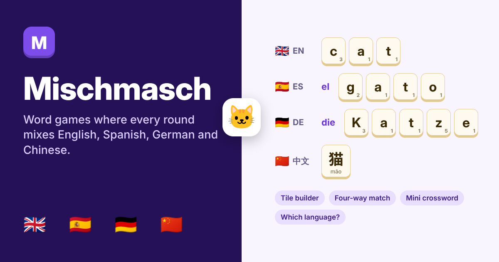

# Mischmasch

Word games for a child learning four languages at once. A tile builder, a four-way picture match, a mini crossword and a language spotter, where every round mixes English, Spanish, German and Chinese.

Live: https://mischmasch-words.vercel.app



## The problem

My son is eight. At school in Málaga he learns in English and Spanish, and this year he started German and Chinese from zero. He loves letter-tile word games, and he plays them for far longer than he would ever sit with a vocabulary list.

Living abroad, no screen time at all isn't realistic for us, so I keep his screen time to his school syllabus. That made this a learning tool built around his textbooks, with the games there to keep him coming back to it. The hand-checked word bank was the plan from day one for the same reason.

Practice apps keep each language in its own box: pick one, do a lesson, switch. That isn't how he meets these languages. In one school day he hears a word in Spanish, reads it in English, and gets a German or Chinese version in class. I wanted a game where the languages sit side by side, so seeing *el gato* reminds him of *die Katze* and 猫, and where spelling something in one language starts from a clue in another.

There is a second problem for a parent. A model can make endless new rounds, but I don't want a child learning a made-up German word or a wrong Chinese tone. So the core words are written in and checked, and the model is only used for optional extra sets that a grown-up reviews first.

## What it does

| | |
| --- | --- |
| 🧩 **Tile builder** | A picture and a word in one language; spell it in another from letter tiles. The language to spell in rotates through all four. Chinese rounds use character tiles with pinyin printed on each. Rarer letters score more, and a word with no hints or wrong tries earns 5 extra. |
| 🔷 **Four-way match** | One picture, four rows: English, Spanish, German and Chinese. Pick the right word in each row; wrong choices come from the same topic, so a colour is up against colours. All four right earns a bonus. |
| ⬛ **Mini crossword** | A small grid built fresh each time. Every clue is a picture plus the word in one language, and the answer goes in another: a Chinese clue for a German answer, a Spanish clue for an English one. An on-screen keypad adds Á É Í Ó Ú Ñ or Ä Ö Ü ß when the answer needs them. |
| 🌍 **Which language?** | Two kinds of question, alternating. Spot which language a word is in, then the odd one out: four words in four languages where three mean the same thing. |
| 📖 **Word bank** | Every word with its picture, in all four languages, each read aloud. Doubles as a homework checker. |
| ✨ **New words** | Pick a topic (or type one) and a model suggests eight new words in all four languages. A grown-up unticks anything that looks wrong before the set joins the games. |
| ℹ️ **For grown-ups** | A one-screen sheet on where the words come from, what the AI does and what is stored. |

Every word can be heard. German and Spanish nouns show *der*, *die*, *das* or *el*, *la* in colour, and Chinese always shows pinyin with tone marks.

## The words

The 112 core words cover greetings, numbers, colours, people, animals, food, school, the body, sport and music, the world around us and getting around. They are pitched at 3º Primaria at a bilingual school in Spain, and the levels differ by language on purpose:

| Language | His book this year | Level here |
| --- | --- | --- |
| 🇬🇧 English | *Amazing Journey 4* (Richmond), *Cambridge Primary Reading Anthologies 3* | Everyday words plus stretch words up to 10 letters |
| 🇪🇸 Spanish | *Lengua 3* (Grazalema) | Everyday words plus stretch words, with accented letters on the tiles |
| 🇩🇪 German | *Paul, Lisa & Co Starter* (Hueber) | Starter words, nouns with their article |
| 🇨🇳 Chinese | *Kuaile Hanyu 1* (快乐汉语 第一册) | Starter words in simplified characters with pinyin |

English and Spanish are his school languages, so 20 **big words** (butterfly / mariposa, volcano / volcán, library / biblioteca) are only ever asked in those two. Their German and Chinese appear as clues and in the word bank, never as something to spell or pick. A switch on the Play page turns big words off.

The words follow the level and topics of these books. They are not copied from the books' own word lists.

## How the AI is used, and how it is kept in check

The games never call a model. Rounds are built by fixed rules in the browser from the hand-checked bank, so a child never sees a translation nobody checked.

The model only appears on **New words**, and only when a grown-up asks:

1. The topic goes to a serverless function that holds the prompt and key. The prompt asks for eight concrete, picturable words for an 8-year-old, with Spain's Spanish and Germany's German, and tells the model to refuse a topic that isn't right for a child.
2. The model replies in tagged lines, not JSON: `WORD|🦀|crab|el|cangrejo|die|Krabbe|螃蟹|páng xiè`.
3. Every line is checked in the browser before it is shown. It must have a picture and all four languages; the Spanish article must be el, la, los or las and the German der, die or das; the Chinese must be 1 to 4 characters with exactly one pinyin syllable per character, using only letters and tone marks; and the word must not already be in the bank. Lines that fail are dropped and listed with the reason.
4. The grown-up sees the set, unticks anything that looks wrong and adds the rest. Those words carry a **Made by AI** tag wherever they appear.

The shape checks catch broken output. They cannot prove a translation is right, which is why the human review step is there and why the core bank stays hand-written.

It runs on Meta Muse Glimmer through NVIDIA's free endpoint by default, on my key. Visitors can switch to Anthropic, OpenAI or Gemini with their own key, which is used for one request and never stored.

### Three saved examples

So the New words screen can be tried without any key, three sets are written in: **Space** (rocket, astronaut, comet, satellite…), **Clothes** (hat, sock, scarf, glove…) and **At the beach** (shell, crab, bucket, dolphin…). They load into the same review screen as a model result and can be added to the games in one tap. They are labelled as hand-checked examples, not model output.

## Product decisions

- **Mixing is the point.** No game has a language picker. The tile builder rotates the target language, the match asks for all four, each crossword answer is in a different language from its clue.
- **Clue in one language, answer in another.** Translating between his new languages and his strong ones is harder than recognising a word, and it is how he will use them.
- **Different levels per language.** A single difficulty would be too easy in English and too hard in Chinese. Stretch words solve that without splitting the games.
- **German capitals stay.** German nouns keep their capital letter on the tiles, because spelling *Katze* with a small k is wrong.
- **Rarer letters score more.** Q, X, Z, Ñ, Ü and ß are worth the most, which nudges attention to the letters that make each language look like itself. The table is my own, by how rare a letter is across these four languages.
- **Grown-up in the loop for anything a model makes.** Review before add, a visible tag after, and a one-tap remove.
- **Nothing to sign up for.** Scores, stars, topic choices and added sets stay in the browser. The only thing sent anywhere is the topic typed into New words.

## What happened when he played it

He played all four games and liked it a lot. The language mixing worked the way I hoped: he is picking up new words and can now say and recall them across languages.

What I hadn't accounted for is how uneven his four languages are. I pitched each one at his textbook's level for the year, but his class hasn't covered the same amount in each book yet, and he knows some languages far better than others. In Chinese especially he was guessing at a lot of words. A guess that lands right in the four-way match still scores, so a good score there can hide that he didn't know the word.

That changes what I would build next:

- **Follow what has been taught.** The Chinese and German pools should grow lesson by lesson with his class, the way Hallo Nǐ Hǎo does, instead of covering the whole year's topics from the start.
- **Separate knowing from guessing.** Ask for a quick "I knew it / I guessed" tap, or track words he gets right once and wrong later, so the score reflects what he actually knows.
- **Level per language, set by the parent.** A simple setting for how far into each book he is would keep every round in reach without taking the mixing away.

## Limits

- Speech uses the voices already on the device. Most phones and tablets have all four; where one is missing, its speaker button stays quiet and the word bank says so.
- The crossword uses English, Spanish and German answers only, since characters don't share letters with a grid. Chinese appears in its clues.
- Words from a model pass shape checks, not a teacher's check. Review them before adding.

## Run it

```bash
cd mischmasch
npm install
npx vercel dev   # runs the app and the /api/words function together
```

`npm run dev` runs the games on their own; New words needs the function.

| Variable | Value |
| --- | --- |
| `LLM_BASE_URL` | `https://integrate.api.nvidia.com/v1` |
| `LLM_MODEL` | The Muse Glimmer model id on NVIDIA |
| `LLM_API_KEY` | Your NVIDIA API key |

## Files

| File | What it holds |
| --- | --- |
| `src/words.js` | The hand-checked word bank and topics |
| `src/game.js` | Round building for all four games, tile values and the crossword layout |
| `src/aiwords.js` | Line checks for model output, and the three saved example sets |
| `src/Games.jsx` | The four games |
| `src/App.jsx` | Sidebar, Play page, word bank, New words and the grown-ups page |
| `api/words.js` | The prompt and the provider calls |

## Built with

React and Vite, deployed on Vercel. Icons from Lucide. Fonts: Fredoka and Lexend.

Product brief, design decisions and review by Prerna Kakkar. Code written by AI coding tools working from my prompts and review.
