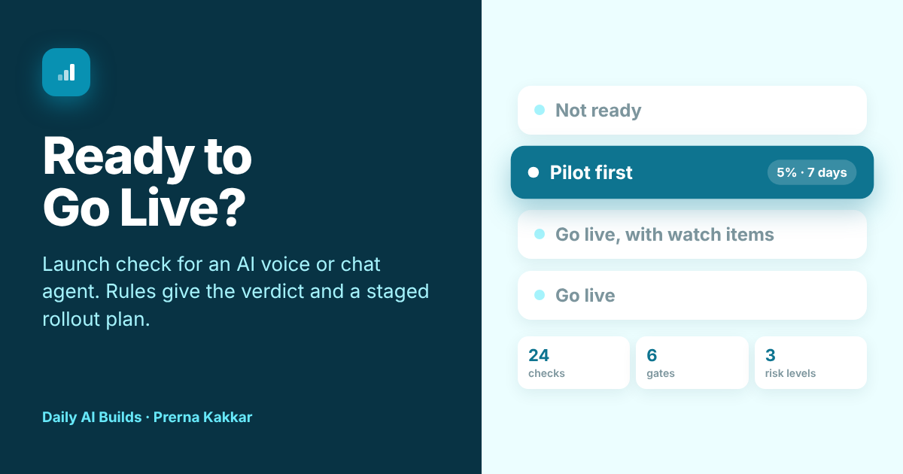

# Ready to Go Live?

**A launch check for an AI voice or chat agent going live at a customer. Answer 24 readiness checks and paste your rollout notes. Printed rules mark each check as a pass, gap or blocker, set a verdict and write a staged rollout plan with exit criteria and rollback triggers. A model reads your notes and flags any answer they contradict, quoting your own words.**

[Live app](https://ready-to-go-live.vercel.app) · Three worked examples run without a key



---

## The problem

At Jinn Live I worked on rolling out voice agents and chatbots for enterprise customers, through a five-stage deployment. The launches that went badly rarely failed on the model. They failed on things nobody had written down: a test set built from scripted calls, a handoff to the billing team that had never been tried with their queue, an FAQ that whoever last edited it owned.

One of those taught me the most. A voice agent stated wrong figures once every 10 to 15 calls, and we treated each report as a one-off until we saw the pattern. The cause was a cached, older copy of the knowledge base. After that, checking the knowledge base version became a step before closing any wrong-answer report.

The go-live call usually happens in a meeting, with a launch date already promised. Ready to Go Live? turns it into a checklist the delivery team and the customer can argue about before the date, with a rollout plan that lets the agent prove itself on a small share of traffic first.

## What it does

| | |
| --- | --- |
| **Describe it** | The agent, its channel, launch languages, volume and what it can change, then chip answers for 24 checks across six gates. Every chip row takes your own answer too. Your rollout notes go in a text box for the model to read |
| **Verdict, live** | Not ready, Pilot first, Go live with watch items, or Go live. It updates as you answer, with a readiness score out of 100 shown for context |
| **Rule trail** | The risk level and the rule that set the verdict |
| **Second read** | A model checks your answers against your notes. Where the notes point to a different answer, it quotes them and you can apply the change with one click. It also flags risks in the notes that the form does not ask about |
| **Checks** | All 24 checks by gate, each with its status, the fix and who owns it: our team, the customer or both |
| **Rollout plan** | Stages with a traffic share, minimum days, scope and exit criteria, plus rollback triggers to set alerts on |
| **Launch note** | Questions to settle with the customer and a Markdown go or no-go note with every check, ready for an email, Notion, Confluence or a ticket |

## The design choice that matters

**Rules decide. A model reads.** A launch decision has to come out the same way every time for the same evidence, so every status, the verdict and the rollout plan come from printed rules in `src/rules.js`. The model never sets any of them.

What the model does is the part rules are bad at: reading a page of handover notes and noticing that they disagree with the boxes someone ticked. In the Clara example the team said the agent books and updates records. The notes say it can also switch a customer's tariff and cancel a direct debit. Apply that suggestion and the risk moves from Medium to High, and every threshold tightens with it.

Every suggestion is checked before it counts. The quote has to appear in your notes and the suggested answer has to be one of the listed options. Neither check depends on the model. Nothing changes until you click to apply it.

This is the same split as Which Tier?, Wrong Turn and Who Does What? in this repo.

## The six gates

| Gate | Checks |
| --- | --- |
| **Scope and success** | Use cases signed off, success metrics with a baseline, a named customer owner |
| **Test evidence** | Test set size, real against scripted cases, task success, critical failures, languages and accents, real phone lines for voice |
| **Connected systems** | End-to-end testing, behaviour when a system is down, knowledge base version and owner |
| **Handoff to people** | Route to a person, what they receive, out-of-hours handling |
| **Safety and data** | AI disclosure at the start, recording and lawful basis, personal data in logs, out-of-scope requests |
| **Launch operations** | Monitoring and alerts, daily reading of conversations, a tested off switch, a briefed frontline team, launch week cover |

## The rules

| Rule | What it does |
| --- | --- |
| **R1** | Risk comes from what the agent can do. Answering questions is Low, or Medium above 5,000 conversations a day. Updating records is Medium. Moving money, changing contracts or giving health, legal or money guidance is High |
| **T1 to T6** | Test evidence is judged against the risk level. Scripted-only tests block a voice or high-risk launch. Unmeasured success or failure rates block a medium or high-risk launch |
| **C1 to C3** | Connected systems need end-to-end tests and a defined response when one is down. The knowledge base needs a pinned version and an owner |
| **H1 to H3** | Every conversation needs a route to a person. A callback alone blocks a high-risk launch |
| **D1 to D4** | AI disclosure at the start is required under Article 50 of the EU AI Act, in force since 2 August 2026. Recording, personal data and out-of-scope requests are checked |
| **O1 to O5** | Monitoring, daily reading of conversations, a tested off switch, a briefed frontline team and named cover on both sides |
| **V1** | Any blocker: Not ready |
| **V2** | No blockers, but four or more gaps, or any gap in test evidence or handoff: Pilot first |
| **V3** | No blockers and one to three gaps elsewhere: Go live, with watch items |
| **V4** | Every applicable check passed: Go live |
| **P1** | Stage sizes, minimum days, exit criteria and rollback triggers follow the verdict and risk level |
| **M1** | A model suggestion counts only if its quote is in the notes and its answer is a listed option |
| **A1** | A typed-in answer counts as a gap until a listed option is picked |

## Thresholds by risk

| | Low | Medium | High |
| --- | --- | --- | --- |
| Critical failures, at most | 2% | 1% | 0.5% |
| Task success, at least | 75% | 80% | 85% |
| Test set, at least | 100 cases | 200 cases | 300 cases |
| Conversations reviewed per stage | 100 | 200 | 300 |

These are starting points to agree with the customer, not industry standards. Some sectors will want stricter ones.

## The three worked examples

| Example | Verdict | What it shows |
| --- | --- | --- |
| **Clara at Solenia Energía** (energy retail, voice) | Not ready | A billing line agent booked to take every call on day one, tested on 140 scripted calls in a browser console. The second read finds it can change tariffs and direct debits. Apply it and the risk moves to High |
| **Turno at Nácar Dental** (clinic booking, WhatsApp) | Pilot first | Strong tests and monitoring, but half the test set is written by the team, handoff is a callback and evening messages have no owner. The second read finds the no-clinical-advice rule exists only in the prompt |
| **Ask Fieldnote** (B2B SaaS help centre, web chat) | Go live, with watch items | 640 real test questions and two small watch items. The second read finds it also opens tickets in a system only tested against a mock. Apply it and the verdict drops to Not ready |

Companies, agents and people in the examples are invented.

## What it cannot do

It judges the answers you give, so a generous answer gives a generous verdict. It does not test the agent, read transcripts or replace a legal review of recording and data processing. The second read only sees what the notes say, so a risk nobody wrote down stays invisible to it.

## Model and keys

The default model is Meta's Muse Glimmer 30B on NVIDIA's free endpoint, running on this site's key, held in a serverless function and never sent to the browser. Visitors can switch to Anthropic, OpenAI or Gemini with their own key, which is sent once with the request and never stored. The prompt lives in the function and builds its list of allowed answers from the same file the rules use, so the two cannot drift apart. Output comes back as tagged lines rather than JSON, which keeps the provider swap cheap. The rules need no model at all.

## Run it locally

```bash
npm install
npx vercel dev
```

Set these environment variables for the default model:

```
LLM_BASE_URL=https://integrate.api.nvidia.com/v1
LLM_MODEL=<Muse Glimmer model id>
LLM_API_KEY=<your NVIDIA key>
```

Without them, the rules and the worked examples still run, and visitors can bring their own key.

## Stack

React and Vite, deployed on Vercel. One serverless function (`api/read.js`). The checks, risk levels, verdict rules, rollout plan, quote check and note export live in `src/rules.js`. Icons from Lucide.

## Sources

- [Regulation (EU) 2024/1689, the AI Act, Article 50](https://eur-lex.europa.eu/eli/reg/2024/1689/oj/eng)
- [European Commission guidelines on AI transparency obligations](https://digital-strategy.ec.europa.eu/en/policies/guidelines-ai-transparency-obligations)
- The checks draw on the voice and chat agent rollouts I worked on at Jinn Live. The thresholds are defaults set for this tool

---

Part of [Daily AI Builds](../) by Prerna Kakkar.
