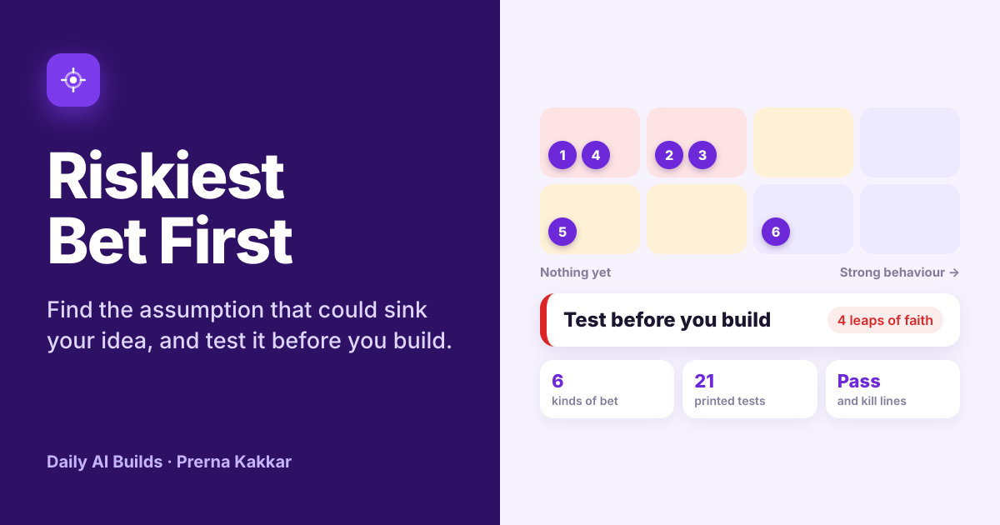

# Riskiest Bet First

**Find the assumption that could sink a new product idea, and test it before anyone builds. A model reads your idea notes and lists what they take for granted, quoting your own words. Printed rules score every bet, put the riskiest first, say whether to build yet and pick the cheapest test for each one, with a pass line and a kill line agreed before it runs.**

[Live app](https://riskiest-bet-first.vercel.app) · Three worked examples run without a key



---

## The problem

At Ylytic we built Nudge, a mobile app that turned a creator's analytics into goal-based notifications. We shut it down after three months. The idea suited one tier of creators: nano accounts had no use for data-driven nudges, and the biggest accounts already had dashboards and teams. Mid-tier creators were the right fit, and they were too expensive to reach for a bootstrapped startup.

Nothing about that was hidden. It was sitting in the pitch as a sentence about word of mouth, treated as settled. The lesson I took was about order: talk to real users, and test the bet that would kill the idea, before writing a roadmap.

Most new ideas rest on six to ten bets like that. Teams tend to test the comfortable ones first, usually whether they can build it, because that is the work they know. Riskiest Bet First puts the bets in the order they should be tested and gives each one a test small enough to run this month.

## What it does

| | |
| --- | --- |
| **Describe it** | The idea, who it is for, a time box for testing and your notes: a pitch, a one-pager or a plain description |
| **Find the assumptions** | A model reads the notes and suggests the bets they take for granted, each with the words it is quoting, a category and the evidence the notes give |
| **Your bets** | Every bet with two chip answers: how bad it would be if wrong, and what evidence you have. Add your own, edit any of them, or add the model's suggestions one by one |
| **Bet board** | The verdict, a grid of impact against evidence showing where each bet sits, and the bets ranked riskiest first with the rule trail |
| **Test plan** | The cheapest test for each bet worth testing, laid out across your time box, with cost, what to measure, a pass line and a kill line. Swap any test for another in the same category |
| **Decision note** | Interview questions about past behaviour, and a Markdown note with the verdict, every bet and the full plan, ready for an email, Notion, Confluence or a ticket |

## The design choice that matters

**Rules decide. A model reads.** Whether to build should come out the same way for the same evidence, so every score, the ranking, the verdict and every test come from printed rules in `src/rules.js`. The model never sets any of them.

What the model does is the part rules are bad at: reading a page of notes and spotting the sentences that quietly assume something. "We can recruit the first creators by hand and grow through word of mouth after that" is a reach bet with nothing behind it. A rule cannot find that sentence. A model can, and it has to quote it.

Every suggestion is checked before it shows. The quote has to appear in your notes, and the category and evidence level have to be listed options. A second check, rule E1, caps the evidence when the quote only reports what people said. If the model rates "they loved the idea" as behaviour, the app marks it down to Opinions only and says so. Neither check depends on the model.

This is the same split as Ready to Go Live?, Which Tier? and Who Does What? in this repo.

## Six kinds of bet

| Category | What has to be true |
| --- | --- |
| **The problem is real** (core) | People have this problem often enough, and badly enough, to act on it |
| **They will choose it** (core) | People will pick this over what they do today, and give time or money for it |
| **We can reach them** (core) | You can get it in front of the right people at a cost that works |
| **They can use it** | People can work out how to use it without help |
| **We can build it** | The team can build it to the quality needed, with the data and access it has |
| **The numbers work** | It earns or saves more than it costs to build, run and sell |

These follow the value, usability, feasibility and viability risks common in product discovery, with reach split out because that is where Nudge broke.

## The rules

| Rule | What it does |
| --- | --- |
| **R1** | Score = impact if wrong (Kills the idea 3, Hurts it 2, Minor 1) × uncertainty (Nothing yet 4, Opinions only 3, Some behaviour 2, Strong behaviour 1). The highest possible is 12 |
| **R2** | 9 or more is a leap of faith: it could kill the idea and nothing or only opinions back it. 6 to 8 is test soon. Under 6 is watch |
| **R3** | Rank: leaps first, then test soon, then watch. Inside each band, the problem, demand and reach come before use, building and numbers, then the higher score |
| **C1** | A core category with nothing written down counts as a leap of faith |
| **V1** | Any leap of faith about the problem, demand or reach: **Test before you build** |
| **V2** | Leaps of faith only about use, building or numbers: **Prototype first** |
| **V3** | No leaps, but bets scoring 6 to 8: **Build a thin slice** |
| **V4** | Nothing scores 6 or more: **Build it** |
| **T1** | Each bet scoring 6 or more gets a test from the printed library, chosen by its category, its evidence and who the idea is for. Bets under 6 get a metric to watch |
| **T2** | Any test can be swapped for another in the same category. The pass and kill lines come with it |
| **S1** | Tests run one after another in rank order. Those that end after the time box move to later |
| **S2** | Two bets that need the same test share one run of it |
| **M1** | A model suggestion shows only if its quote is in the notes and its category and evidence are listed options |
| **E1** | If the model rates a quote as behaviour but the quote only reports what people said, liked or would do, the evidence is capped at Opinions only |
| **D1** | A suggestion joins your list at Hurts it. How bad it would be if wrong is your call |
| **A1** | A typed-in impact counts as Kills the idea and typed-in evidence as Opinions only. A typed-in segment uses the small business tests, and a typed-in time box counts five working days a week |

## The test library

21 tests, each with a cost, a measure, a pass line and a kill line. Bets with nothing or only opinions behind them get an early test. Bets with some behaviour get a stronger one. Some tests change with who the idea is for.

| Category | Early test | Next test |
| --- | --- | --- |
| The problem is real | Problem interviews, 10 people, about the last time it happened | Workaround audit with 5 people |
| They will choose it | Fake door; buyer interviews for large companies; ask team leads for people if internal | Concierge run for consumers; paid pilot or letter of intent for businesses; manual pilot if internal. A feature flag test is also offered |
| We can reach them | Channel test; outbound test for large companies; rollout path check if internal | Repeat at double spend; referral ask; second team |
| They can use it | Prototype test with 5 people | Unmoderated test with 15 people |
| We can build it | Spike on the hardest part, or 50 real inputs through the model for an AI feature | Load and cost check |
| The numbers work | One-page unit economics, or cost against time saved if internal | Price test |

The pass and kill lines are starting points to agree as a team, not industry standards.

## The three worked examples

| Example | Verdict | What it shows |
| --- | --- | --- |
| **Nudge, run back in time** (creator analytics, my own product) | Test before you build | The notes rebuild the pitch as it looked at the start. Reaching creators comes out as the riskiest bet, ahead of whether creators would pay. The model rated "they loved the idea" as behaviour, and rule E1 caps it at opinions |
| **Pipeline Doctor** (B2B data platform) | Prototype first | Demand has ticket data and signed letters of intent behind it. Nobody has tried the model on real logs or priced a diagnosis, so a spike and a unit economics sheet come first |
| **Listing Lens** (second-hand marketplace, GenAI) | Build a thin slice | Funnel data, a fake door and a model spike are in hand. The open bet is whether sellers keep a suggested price, so both value bets share one feature flag test inside two weeks |

The Nudge notes are a reconstruction for this tool, not the original document. Pipeline Doctor and Listing Lens, and the companies behind them, are invented.

## What it cannot do

It ranks the bets you give it, so a bet nobody writes down stays invisible, apart from the three core categories rule C1 checks for. A generous evidence answer gives a generous verdict. It does not run the tests, and a passed test lowers the risk without removing it.

## What I would test next

So far the only real case behind it is Nudge, rebuilt after the fact, and I knew the answer before I ran it. That shows the rules can find a bet that was already known to be fatal. It does not show they can find one nobody has spotted yet.

- **Run it before the answer is known.** I would give it to a founder or PM at the idea stage, keep their ranked bets, and come back after their first tests to see whether the bet that hurt them was near the top.
- **Watch the evidence answers.** The verdict leans on how honestly people rate their own evidence. If teams keep calling a few friendly conversations "behaviour", rule E1 needs to ask for more than a label.
- **Check whether reach deserves its own category.** I split it out because that is where Nudge broke. If it rarely ranks first for anyone else, it may belong back inside viability.

## Model and keys

The default model is Meta's Muse Glimmer 30B on NVIDIA's free endpoint, running on this site's key, held in a serverless function and never sent to the browser. Visitors can switch to Anthropic, OpenAI or Gemini with their own key, which is sent once with the request and never stored. The prompt lives in the function and builds its category and evidence lists from the same file the rules use, so the two cannot drift apart. Output comes back as tagged lines rather than JSON, which keeps the provider swap cheap. The rules, the plan and the examples need no model at all.

## Run it locally

```bash
npm install
npx vercel dev
```

Set these environment variables for the default model:

```
LLM_BASE_URL=https://integrate.api.nvidia.com/v1
LLM_MODEL=<Muse Glimmer model id>
LLM_API_KEY=<your NVIDIA key>
```

Without them, the rules and the worked examples still run, and visitors can bring their own key.

## Stack

React and Vite, deployed on Vercel. One serverless function (`api/read.js`). The categories, scoring, verdict rules, test library, plan, quote and evidence checks and note export live in `src/rules.js`. Icons from Lucide.

## Sources

- The Nudge example and the order of the categories come from my own work as founding product hire at Ylytic
- Marty Cagan, [The Four Big Risks](https://svpg.com/four-big-risks/), for the value, usability, feasibility and viability split
- Rob Fitzpatrick, *The Mom Test*, for asking about past behaviour rather than opinions, which rule E1 and the interview questions follow
- David J. Bland and Alexander Osterwalder, *Testing Business Ideas*, for assumption mapping by importance and evidence

---

Part of [Daily AI Builds](../) by Prerna Kakkar.
