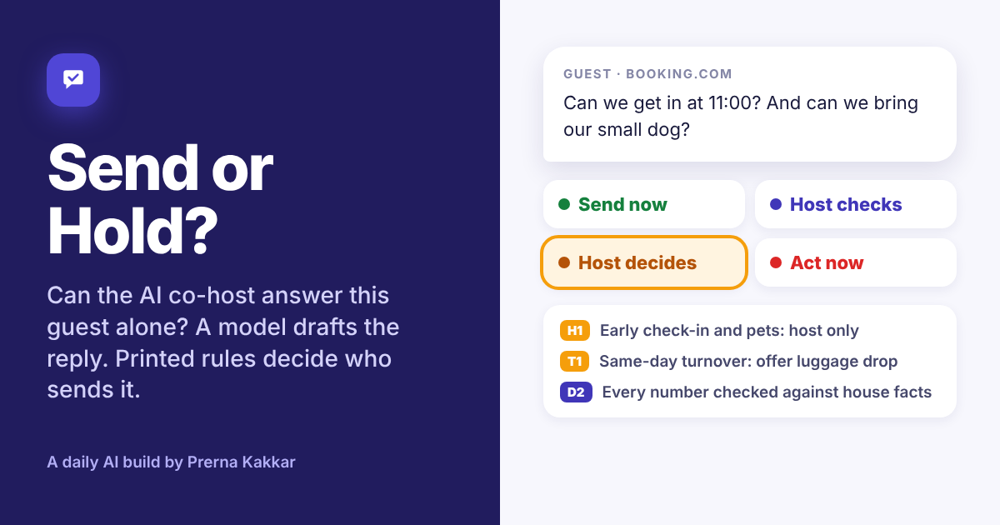

# Send or Hold?

**Can the AI co-host answer this guest alone? Paste a guest message and your house facts. A model reads the message, quotes what the guest wants and drafts a reply in their language. Printed rules then put the message in one of four lanes: Send now, Host checks, Host decides or Act now. Every quote is checked against the message, every fact against your house facts, and every time, code and number in the draft against both.**

[Live app](https://send-or-hold.vercel.app) · Three worked examples run without a key



---

## The problem

Holiday rental hosts live in their inbox. Most guest messages are the same ten questions (the wifi, parking, check-in time, where to eat) and an AI co-host should answer those in seconds, at any hour, in the guest's language. That is the easy part.

The hard part is the other messages. A guest asks to arrive at 11:00 on a day another guest checks out at 11:00. A guest asks for a discount for two extra nights. A guest wants to bring a dog and the house manual says nothing about pets. A guest writes at midnight that the kitchen smells of gas. An assistant that answers all of these as fluently as it answers the wifi question is a liability, and a host who has to read every reply before it goes has gained very little.

Writing a good reply is the part models already do well. The product question for an AI co-host is which replies can go out without the host, and what the host needs in front of them when one can't.

At Jinn Live I built voice agents and chatbots with human handoff. This build asks the same handoff question for holiday rental guests.

## How I got here

My husband and I own holiday rentals in Málaga. A property manager runs them day to day and we follow bookings in Lodgify, and I have read the guest messages that come in myself. Most of them really are the wifi and the parking. The ones that worried me were the few that looked just as routine on the surface: a polite question about arriving early that clashes with someone else's checkout, or a pet request the house manual never mentions.

I started with three lanes: auto-send, host review, and host must act. That split didn't hold. "Host review" was covering two different jobs. One is a draft that only needs a second look before it goes. The other is a request, such as an early arrival, a discount or a dog, that no draft can answer, because only the host can agree to it. The first needs a send button. The second needs the guest's exact words and a few options to choose from. So host review became two lanes, Host checks and Host decides, and the host note was built around the second one.

## What it does

| | |
| --- | --- |
| **Inbox** | The property, where the booking came from, the booking stage, when the message arrived, what is on the calendar either side of the stay, the guest message and your house facts. A live lane updates as you type, and the safety word list runs before any model call |
| **Routing** | The lane, a four-step lane track, every ask quoted from the message, every signal (danger, lock-out, upset, party, off-platform, asking for a person, police or legal), the rule trail that set the lane, and the quote check |
| **Reply** | What actually goes to the guest in this lane: the draft, the holding reply, or the fixed safety message. Below it, the model's draft line by line with stray numbers and unapproved offers highlighted |
| **Host note** | Each decision the host has to make, with the guest's words and two or three options to pick from, then a Markdown note for WhatsApp, email or a team channel that records the host's call |
| **Co-host rules** | How much the co-host does alone (Cautious, Balanced or Hands-off), what it may never promise without the host, your own watch words, and the languages you read |

## The four lanes

| Lane | What happens |
| --- | --- |
| **Send now** | The co-host sends the draft alone. Every answer in it comes from your house facts |
| **Host checks** | The draft is ready, but a person reads it first. One tap to send |
| **Host decides** | The guest wants something only the host can agree. The holding reply goes now, the host decides |
| **Act now** | Someone may be in danger or cannot get in. A fixed safety message goes out, and the host phones the guest |

## The design choice that matters

**A model drafts. Rules decide who sends.** Reading a guest message well needs a model: "si podemos llevar a nuestra perrita" is a pet request, and "the kids are asleep upstairs" changes how serious a gas smell is. Deciding whether a reply can go out alone should not need one. The same message and settings should get the same lane every time, and a host should be able to read why.

So the model never picks the lane. It returns tagged lines: what the guest asks, how the message reads, which house facts it used, what the facts don't answer, a draft and a holding reply. Printed rules in `src/rules.js` do the rest.

Four things keep the model honest:

1. **Quotes are checked.** An ask or signal counts only if its words are in the message, and a fact counts only if it is in your house facts. Anything else is dropped and listed.
2. **Safety runs without the model.** A narrow list of phrases in English, Spanish, German and French (gas smells, smoke, flooding, injuries, lock-outs) sends a message to Act now before any model call. If the model misses it, the list still catches it, and the app says so.
3. **The draft is checked line by line.** Any time, code or number in the draft that is not in your facts or the message holds it for a person. Any offer on your never-promise list that the guest did not ask for (a discount to say sorry, an early check-in) holds it for the host.
4. **Act now never sends model text.** The safety message is printed in the app, in English and Spanish, and points to 112.

This is the same split as Wrong Turn, Who Does What? and Pass the Call in this repo: the model describes, the rules decide.

## The rules

| Rule | What it does |
| --- | --- |
| **Q1** | An ask or signal counts only if its quote is in the guest message, word for word |
| **Q2** | A fact counts only if it is in your house facts, word for word |
| **Q3** | Kinds must be on the printed lists. Anything else is dropped |
| **S0** | A safety phrase in the message means Act now, before and without the model |
| **S1** | A Danger or Cannot get in signal means Act now |
| **H1** | An ask on your never-promise list means Host decides |
| **H2** | Upset, party, off-platform, asking for a person, or police and legal means Host decides. Off-platform is ignored for direct bookings and WhatsApp |
| **H3** | Something broken with no fix in your house facts means Host decides. With a fix in them: Host checks |
| **G1** | A question your house facts do not answer means Host checks, and the host note says what to add |
| **G2** | An ask the model could not place means Host checks |
| **D1** | A draft that offers anything on your never-promise list unasked, or uses one of your own watch words, means Host decides |
| **D2** | A draft that gives a time, code or number not in your house facts or the message means Host checks |
| **C1** | An enquiry about availability before booking means Host checks, unless Hands-off |
| **C2** | A message in a language you do not read means Host checks, unless Hands-off |
| **C3** | Four or more asks in one message means Host checks, since one may be missed |
| **C4** | Cautious: nothing goes out alone, so the lowest lane is Host checks |
| **N1** | Act now at night: phone the host, do not wait for the app |
| **N2** | Host decides at night: the holding reply goes now, the decision waits for the morning unless they arrive today |
| **T1** | Early check-in or late check-out against a same-day turnover: the note offers luggage drop instead |
| **V** | The lane is the highest one any rule sets. Send now needs every rule to pass |

## Worked examples

All three properties, guests and places are invented. Each has a saved model read, so it opens without a key.

| Example | What it shows | Lane |
| --- | --- | --- |
| **Wifi, parking and tapas** | Three routine questions, all answered by the house facts. Switch the co-host to Cautious and the lane moves to Host checks | Send now |
| **Early arrival, a dog and a discount** | A guest writing in Spanish asks for three things only the host can agree, on a day with a same-day turnover. Pets are missing from the house facts, so the note says to add them | Host decides |
| **A gas smell at night** | Children asleep and a gas smell, on Hands-off. The word list and the model both catch it, the fixed safety message replaces the draft, and the night rule says to phone | Act now |

## How it is built

- **React and Vite**, one page, with a fixed left sidebar and icons from Lucide.
- **One serverless function**, `api/read.js`, holds the prompt and the key, so neither reaches the browser.
- **Muse Glimmer by default**, through NVIDIA's free endpoint on my key. Visitors can switch to Anthropic, OpenAI or Gemini with their own key, used for one request and never stored.
- **Tagged lines, not JSON.** The model replies in lines like `ASK|timing|To get in at about 11:00|¿Podríamos entrar al piso sobre las 11:00?`. A broken line is skipped and the rest still counts.
- **All lane logic in `src/rules.js`**, the same file the How it works page prints from.

## Run it locally

```bash
cd send-or-hold
npm install
npx vercel dev   # runs the app and the API function together
```

Set these in Vercel or a local `.env.local`:

| Variable | Value |
| --- | --- |
| `LLM_BASE_URL` | `https://integrate.api.nvidia.com/v1` |
| `LLM_MODEL` | The Muse Glimmer model id on NVIDIA |
| `LLM_API_KEY` | Your NVIDIA API key |

## What it cannot do

It reads one message, not the whole thread, so it can miss context from earlier in the conversation. The safety list is short on purpose and can still over-fire: a smoke alarm with a flat battery goes to Act now, which is the right side to err on. It does not know your platform's own rules beyond the off-platform signal, and it never replaces your judgement or a call to 112.

## What I would test next

Nobody outside me has used it yet, so the lanes are still my judgement rather than evidence.

The first person I would put it in front of is the property manager who answers our guests, with a month of their real messages. I would ask them to sort each message into a lane by hand before seeing what the app says, then compare.

- **Where they disagree, and in which direction.** If they keep moving messages up from Send now, the rules are too loose. If they keep pulling messages down from Host decides, the co-host is asking the host about things a manager settles without thinking, and it saves nobody time.
- **What share lands in Send now.** That share is the time the co-host actually saves. If it is small, the build is a triage tool rather than a co-host, which is still useful but a different product.
- **Which house facts were missing.** If the same gaps keep sending messages to Host checks, the fix is a better house manual template, and the rules can stay as they are.
- **Whether one message is enough.** I would rerun the disagreements with the whole thread and see if the lanes change.

---

Built by [Prerna Kakkar](https://github.com/kakkarprerna) as part of [Daily AI Builds](../). I set the brief, the lanes, the rules and the guardrails, and reviewed every version. The code was written by AI coding tools from my prompts and review.
