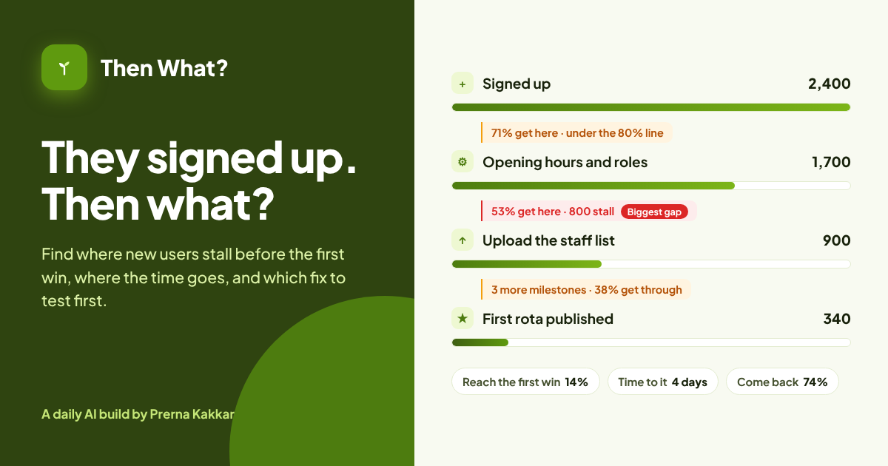

# Then What?

**Find where new users stall between signing up and the first time your product proves its value, and what to fix first. Map the milestones from sign-up to the first win and the next use, add counts and median times if you have them, and paste what you know about the first week. Printed rules find the gaps, show where the time goes, rank every fix and pair each one with a test, the number that decides it and the number to watch. A model reads your notes and points at the moments people stall, quoting your words.**

[Live app](https://then-what-activation.vercel.app) · Three worked examples run without a key



---

## The problem

A sign-up is a promise, not a customer. Most SaaS products lose more people after the account exists than before it: the first screen is empty, setup asks for data nobody has to hand, the product needs a colleague to accept an invite, and by the time any of that is done the reason for signing up has gone cold.

Activation reviews tend to go wrong in two places. The team has never agreed what activated means, so the dashboard counts logins or finished profiles and looks healthy while people leave. Or the team looks only at the share who activate, and never at how long it takes, who had to act, or whether anyone came back after the first win.

[Front Door](../front-door) in this repo looks at the way in, up to the first moment the product works. Then What? picks up from there. It came from running onboarding and customer success alongside product at Ylytic and Jinn Live, where the accounts we lost in month three had usually stalled in week one, and the clues were sitting in tickets and call notes nobody had lined up against the numbers.

## What it does

| | |
| --- | --- |
| **Map activation** | The product, who signs up, what counts as activated today, the activation window, each milestone in order (whether it is needed, who has to act, how many people reach it, the median hours after sign-up), what the first screen shows, the help and nudges in place, activation rate by segment, and your notes |
| **Where they stall** | The verdict, the share who reach the first win, the median time to it, the share who come back afterwards, a milestone ladder with each gap against its alert line, where the time goes on the way to the win, and each segment against the best one |
| **Stuck points** | Every finding, ranked, filtered by phase (setting up, reaching the first win, making it stick), each with the rule or the quote behind it. Hide any finding that does not apply and the verdict updates |
| **Fix plan** | For each finding, the fix, the change to test, the number that says whether it worked and the number to watch so the fix does not break something else, plus questions to check in your data first |
| **Report** | A Markdown review with the verdict, the ladder with its counts and times, every fix in order and the questions, ready for an email, Notion, Confluence or a ticket |

## The design choice that matters

**Rules decide. A model reads.** The same ladder should get the same verdict every time, so every finding, score, ranking, fix and test comes from printed rules in `src/rules.js`. The model never sets any of them.

What the model does is the part rules cannot: read a page of tickets, interview notes and session recording notes and point at the moments people stall. "Owners say staff ignore the invite email or it goes to spam" is a sentence a rule cannot find. A model can, and it has to quote it.

Every moment is checked before it counts. The quote has to appear in your notes word for word, the kind has to be one on the printed list, and the kind sets the severity, not the model. When a moment lands on a milestone a rule already flags, it joins that finding as evidence instead of becoming a duplicate (rule M4). A moment tied to no single milestone joins the matching rule by kind, so "nothing brings them back" lands on the rule about messages after the first win rather than floating loose. An error or dead end always stands on its own, because it needs its own fix.

The rules also check the definition before the numbers. If activation counts a visit, or the team has not agreed one, the verdict is to settle that first (rule V0), because any gap measured against the wrong finish line may be the wrong gap.

This is the same split as Front Door, Riskiest Bet First and Ready to Go Live? in this repo.

## The rules

| Rule | What it does |
| --- | --- |
| **G1** | For each milestone with a count, reach = people at this milestone ÷ people at the one before |
| **G2** | A milestone has a gap when reach falls under its alert line. The milestone losing the most people is the biggest gap |
| **G3** | Counts and times are optional. Without them the findings still stand, ranked on severity alone |
| **G4** | A gap that no rule or note explains becomes an Unexplained gap, with a fix of finding the cause before changing anything |
| **D1** | No first win on the ladder, or the team has not agreed one: High |
| **D2** | Activation counts a visit or sign-in: High. It counts a setup action: Medium |
| **D3** | No second use or regular use after the first win: Medium |
| **P1** | A required milestone before the first win that needs someone else (an invite, an admin, staff accepting): High |
| **P2** | Required import or connection before the first win, with no sample data or template: High |
| **P3** | An empty first screen with no empty-state guidance or checklist: Medium |
| **P4** | More than 3 required milestones between sign-up and the first win: Medium. More than 5: High |
| **P5** | A required install before the first win: Medium |
| **T1** | Median time to the first win over 24 hours: Medium. Over 72 hours: High. For sales-assisted accounts, 7 and 14 days |
| **T2** | One stretch on the way to the first win takes over half the total time and over 24 hours (5 days if sales-assisted): Medium |
| **N1** | No checklist, guidance, tips, week-one nudges or onboarding call before the first win: Medium, High if T1 fires. A welcome email alone does not count |
| **N2** | A milestone after the first win has a gap and nothing is sent after the win: Medium |
| **H1** | Fewer than 40% of people with a first win reach the next second-use or regular-use milestone: High |
| **SG1** | A segment activating at under 60% of the best segment's rate: Medium. Under 40%: High |
| **M1** | A model moment counts only if its quote is in your notes, word for word |
| **M2** | Its kind must be on the printed list. Its milestone number must exist, or it is tied to no milestone |
| **M3** | The kind sets the severity: Waiting on someone and Error or dead end are High; Setup before payoff, Blank start, Value unclear and Nothing brings them back are Medium; Confusing wording is Low |
| **M4** | A moment on a milestone a rule already flags joins that finding as evidence and keeps the higher severity. A moment tied to no milestone joins the matching rule by kind. An error or dead end always stands on its own |
| **R1** | Score = severity (High 3, Medium 2, Low 1) × 2, plus 2 if its milestone has a gap, plus 1 if that is the biggest gap, plus 1 if your notes show it happening |
| **R2** | Rank by score, then setting up before reaching the first win before making it stick, then milestone order |
| **R3** | You can hide a finding. It leaves the ranking and the verdict and stays listed as hidden |
| **V0** | D1 fires, or D2 at High: **Agree what the first win is** |
| **V1** | Any other High finding on the way to the first win: **Shorten the road to the first win** |
| **V2** | No High on the way, but a High after the first win: **Make the first win stick** |
| **V3** | Medium findings only: **Smooth the stuck points** |
| **V4** | Low findings or none: **Measure and tune** |
| **A1** | A milestone type you type yourself uses a 70% alert line and triggers no P rule, only gaps, time and model moments |
| **A2** | You can set your own alert line for any milestone |

## Alert lines

Flag a milestone when fewer than this share of the people at the milestone before it get there.

| Milestone | Line | Milestone | Line |
| --- | --- | --- | --- |
| Setup step | 80% | Pick a template or sample | 85% |
| Import or connect data | 65% | Install something | 70% |
| Invite someone | 55% | First core action | 75% |
| First win | 75% | Second use | 55% |
| Regular use | 65% | Shares the result | 50% |
| Your own type | 70% | | |

**These are starting points I set, not published benchmarks.** Your own history is a better line, and every milestone lets you change it.

## The worked examples

All three products are invented, and their counts and times are illustrative.

| Example | The ladder | Verdict |
| --- | --- | --- |
| **Rota Kit**, shift rotas for restaurants | An empty calendar, pay rates for every role, a staff upload that fails with an unhelpful error, then three staff must accept invites before the first rota can go out. About one in seven owners publishes one, and it takes four days | Shorten the road to the first win |
| **Quillnote**, AI meeting notes | More than half reach a useful first summary on day one. Then the bot has to be switched on for each meeting and nothing reminds people, so only 28% record a second | Make the first win stick |
| **Pingpost**, uptime alerts for developers | A quick sign-up and a checklist that works. The gap sits at the SDK install, where people must redeploy before they see an alert, and agencies activate at about half the rate of in-house teams | Smooth the stuck points |

## What it cannot do

It sees only the milestones, counts, times and notes you give it. It cannot see your product, so a problem nobody wrote down stays invisible unless it shows up as a gap. Counts from different tools, date ranges or cohorts can make a milestone look worse than it is, and a median time hides a long tail. It does not run the tests, and a fix that lifts one segment can hurt another.

## Models and keys

The model call runs in a serverless function (`api/read.js`), so the prompt and key never reach the browser. By default it uses Meta Muse Glimmer on NVIDIA's free endpoint. Visitors can switch to Anthropic, OpenAI or Gemini with their own key, which is sent once with that request and never stored. Replies come back as tagged lines (`STUCK|4|Waiting on someone|...`), so a broken line is skipped rather than breaking the result.

Everything else, including the ladder, the time view, the segments, the findings, the ranking, the verdict and the fix plan, runs in the browser with no key.

## Run it locally

```bash
cd then-what
npm install
npx vercel dev
```

| Variable | Value |
| --- | --- |
| `LLM_BASE_URL` | `https://integrate.api.nvidia.com/v1` |
| `LLM_MODEL` | The Muse Glimmer model id on NVIDIA |
| `LLM_API_KEY` | Your NVIDIA API key |

## Built with

React, Vite and lucide icons, deployed on Vercel. Part of [Daily AI Builds](../). Brief, product and design calls, guardrails and review by Prerna Kakkar. Code written by AI coding tools from her prompts and review.
