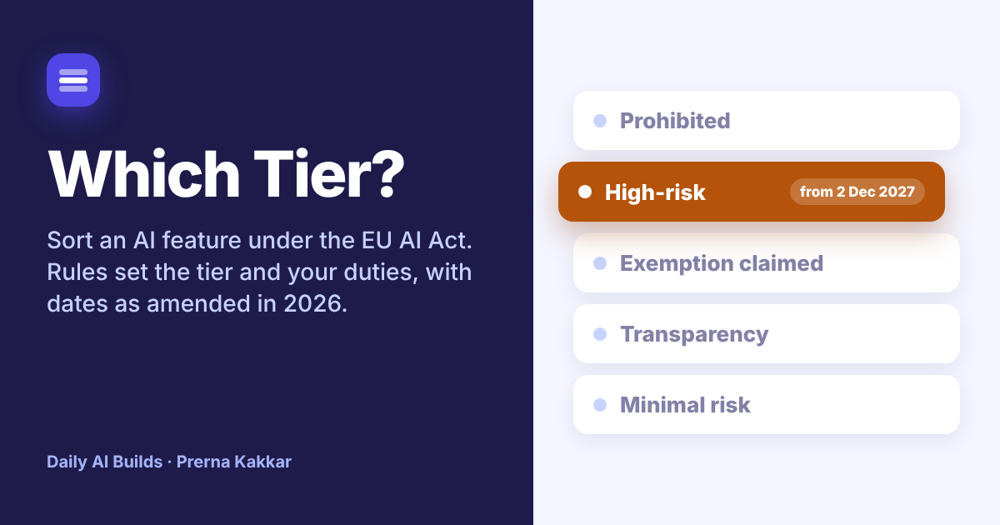

# Which Tier?

**Describe an AI feature and answer a few questions. Printed rules place it in an EU AI Act tier, list what you owe for your role with the article behind each duty, and show which duties apply today and which start later. A model reads your description and flags any answer your own words contradict.**

[Live app](https://which-tier.vercel.app) · Three worked examples run without a key



---

## The problem

On the enterprise AI products I worked on, the AI Act usually came up late. It arrived as one line in a customer's security questionnaire, after the roadmap was set and a ranking feature or an emotion score was already half built. Product teams treated the tier as a legal question to hand over at the end.

The tier is also a product decision. Whether a hiring tool ranks candidates or only reformats their CVs, whether a contact centre tool reads the agent's face or only the words of the call, decides whether the feature is minimal risk, high-risk or banned. Those choices are made in discovery, by the PM.

The dates changed this year as well. The AI Omnibus, Regulation (EU) 2026/1744, came into force on 27 July 2026 and pushed the stand-alone high-risk duties from August 2026 to 2 December 2027. It left the transparency duties where they were, so chatbots and generated content have been covered since 2 August 2026. Teams that read the headline as "the AI Act is delayed" are now out of step on the parts that did not move.

Which Tier? puts that conversation at the start. It gives a first sort a PM can take to legal, with the articles named so legal can check the reasoning instead of starting from a blank page.

## What it does

| | |
| --- | --- |
| **Describe it** | A plain description of the feature, then chip answers: your role, the EU link, banned practices, regulated products, the Annex III area and use, profiling, the Article 6(3) conditions, transparency situations and general-purpose models. Every chip row takes your own answer too |
| **Tier, live** | Prohibited, High-risk (Annex III), High-risk (product safety), Sector rules route, Exemption claimed, Transparency, Minimal risk or Out of scope. It updates as you answer |
| **Rule trail** | Each rule that ran, in order, and which one set the tier |
| **Confidence** | Firm, Provisional or Open, from how many deciding answers are still unsure |
| **Second read** | A model checks your answers against your description. Where your words point to a different answer, it quotes them and you can apply the change with one click |
| **Duties** | What you owe as provider, deployer or both, each with its article, and whether it is in force now or how many days until it starts |
| **What would change the tier** | The design choices that would move the feature up or down |
| **Timeline** | The AI Act dates as amended, with today marked and the dates that start a duty for this feature highlighted |
| **Questions and report** | Open questions from the rules and the model, plus a Markdown report for legal, Notion, Confluence or an email |

## The design choice that matters

**Rules sort. A model reads.** Whether a feature is banned or high-risk has to come out the same way every time, so the tier, the duties and the dates all come from printed rules in `src/rules.js`. The model never sets any of them.

What the model does is the part rules are bad at: reading a paragraph of plain English and noticing that it does not match the boxes someone ticked. In the Shortlist Assist example, the team claimed the Article 6(3) exemption and left profiling as Not sure. The model quotes "ranks candidates from best to weakest match" and suggests profiling is Yes. When you apply it, rule R5 takes over: an Annex III use that profiles people can never use the exemption.

Every suggestion is checked before it counts. The quote has to appear in your description and the suggested answer has to be one of the listed options. Neither check depends on the model. A suggestion never changes an answer on its own. You click to apply it and the rules run again.

This is the same split as What It Counts, Who Does What? and Wrong Turn in this repo.

## The rules

| Rule | What it does |
| --- | --- |
| **R1** | No EU link, a military or national security only use, or research not yet on the market: Out of scope (Art 2). An open source licence only helps systems that are not prohibited, high-risk or under Article 50 |
| **R2** | Any Article 5 practice: Prohibited. This beats every other rule |
| **R3** | A product in Annex I, Section A that needs a notified body check: High-risk (product safety), from 2 August 2028 |
| **R4** | Vehicles, aircraft, rail or marine (Annex I, Section B): Sector rules route |
| **R5** | A listed Annex III use that profiles people: High-risk, no exemption possible |
| **R6** | A listed Annex III use with no profiling and one of the four Article 6(3) conditions: Exemption claimed. Without a condition: High-risk, from 2 December 2027 |
| **R7** | Something else in an Annex III area is listed as an open question, not treated as high-risk on its own |
| **R8** | Any Article 50 situation adds transparency duties, on top of high-risk duties or as the tier when nothing higher applies |
| **R9** | Your own general-purpose model adds Article 53 duties, and Article 55 above 10^25 FLOPs. Building on someone else's model gives you a right to their documentation |
| **R10** | Nothing above applies: Minimal risk |
| **C1** | Confidence counts deciding answers left unsure or typed in by hand. None is Firm, one is Provisional, two or more is Open |
| **M1** | A model suggestion counts only if its quote is in the description and its answer is a listed option |
| **M2** | A suggestion changes nothing until you apply it |

## Dates used

| Date | What applies |
| --- | --- |
| 2 February 2025 | Prohibited practices |
| 2 August 2025 | Duties for providers of new general-purpose models |
| 2 August 2026 | Article 50 transparency duties, not moved by the Omnibus |
| 2 December 2026 | Output marking for generative systems already on the market before 2 August 2026. New prohibitions on non-consensual sexual imagery |
| 2 August 2027 | General-purpose models placed on the market before 2 August 2025 |
| 2 December 2027 | Stand-alone high-risk systems in Annex III |
| 2 August 2028 | High-risk AI in products under Annex I |

Generative systems launched on or after 2 August 2026 have no grace period for marking their output.

## The three worked examples

| Example | Tier | What it shows |
| --- | --- | --- |
| **Shortlist Assist at Talentra** (HR tech SaaS) | High-risk (Annex III) | A team hoping the Article 6(3) exemption applies to a ranking tool. The second read finds profiling and a filter that acts before any recruiter looks |
| **Ask Ana at Luzera Energía** (energy retail) | Transparency | A branded voice and chat agent with duties in force now and a marking deadline in December. The second read flags one sentence about payment risk that could make it high-risk. Apply it and watch the tier move |
| **Calm Meter at Callbright** (contact centre software) | Prohibited | Live stress scores for agents from voice and webcam. Emotion inference at work has been banned since February 2025, whatever the wellbeing intent |

Companies, products and people in the examples are invented.

## What it cannot do

It sorts on your answers, so a wrong answer gives a wrong tier. The chip labels shorten the legal text, which is longer and has exceptions not shown here. It does not cover GDPR, product liability, sector law or national rules, and Commission guidelines and harmonised standards keep arriving that can shift borderline cases. It is a first sort for a product conversation, not legal advice, and the app says so on every page.

## Model and keys

The default model is Meta's Muse Glimmer 30B on NVIDIA's free endpoint, running on this site's key, held in a serverless function and never sent to the browser. Visitors can switch to Anthropic, OpenAI or Gemini with their own key, which is sent once with the request and never stored. The prompt lives in the function too, and builds its list of allowed answers from the same file the rules use, so the two cannot drift apart. Output comes back as tagged lines rather than JSON, which keeps the provider swap cheap. The rules need no model at all.

## Run it locally

```bash
npm install
npx vercel dev
```

Set these environment variables for the default model:

```
LLM_BASE_URL=https://integrate.api.nvidia.com/v1
LLM_MODEL=<Muse Glimmer model id>
LLM_API_KEY=<your NVIDIA key>
```

Without them, the rules and the worked examples still run, and visitors can bring their own key.

## Stack

React and Vite, deployed on Vercel. One serverless function (`api/read.js`). The tiers, rules, duties, dates, quote check and report export live in `src/rules.js`. Icons from Lucide.

## Sources

- [Regulation (EU) 2024/1689, the AI Act](https://eur-lex.europa.eu/eli/reg/2024/1689/oj/eng)
- [Regulation (EU) 2026/1744, the AI Omnibus](https://eur-lex.europa.eu/eli/reg/2026/1744/oj/eng)
- [European Commission guidelines on AI transparency obligations](https://digital-strategy.ec.europa.eu/en/policies/guidelines-ai-transparency-obligations)

---

Part of [Daily AI Builds](../) by Prerna Kakkar.
