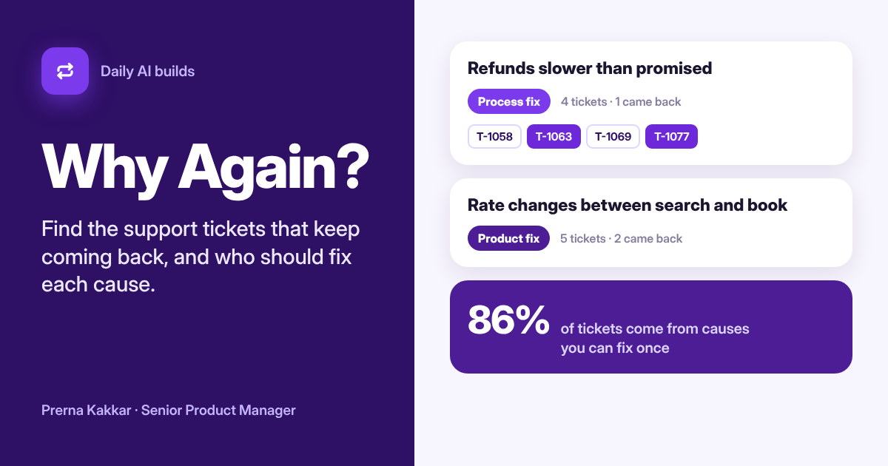

# Why Again?

**Which support tickets keep coming back, and who should fix them? Paste a batch of tickets. A model groups them by underlying cause, quotes one phrase per group and answers four yes or no questions. Printed rules then check every ticket ID and quote against your paste, count the customers who had to write in again about the same thing, put each cause in a fix lane (product, process or help content), rank them and estimate how many contacts a month fixing them could stop. Each owner gets a handoff note with the numbers already in it.**

[Live app](https://why-again.vercel.app) · Three worked examples run without a key



---

## The problem

Support teams are measured on how fast they close tickets. So each ticket gets answered, tagged and closed on its own, and the dashboard looks healthy. What the dashboard does not show is that four of this week's tickets have the same cause as six of last week's, and that two of those customers are writing for the second time.

The tags do not help much. A "refunds" tag puts a refund held up by a manual approval step next to a refund caused by a wrong price at checkout. Those need different owners: one is a finance process, the other is an engineering bug. Grouping by topic gives you a bigger number for "refunds" and no idea who should act.

The question a product or support lead actually needs answered is narrower: which contacts should never have happened, what single change would stop each group of them, and who owns that change.

## How I got here

I ran customer success alongside product at both Ylytic and Jinn Live, so I have been on the receiving end of this.

The case I think about most is from Jinn Live. Our voice agent gave a wrong answer roughly once every 10 to 15 calls. Each report came in on its own and was treated as a one-off: check the call, correct the answer, close it. It took looking at the reports together to see they were one problem. The agent was reading from a stale, cached version of the knowledge base. Once we saw it, the fix was a version check on the knowledge base before closing any wrong-answer report. The fix was small. Seeing that the tickets were one pattern rather than many was the slow part.

This build came up while I was working through the roles I have applied to and the gaps in them. One was a Senior PM role in customer operations, and it pointed at exactly this: turning support volume into product and process changes, rather than answering it faster. Of the four builds I shortlisted that day, this was the one closest to work I have done with my own hands.

The first version I scoped was a ticket categoriser: cluster the tickets, label each cluster, show the biggest. That is what most support tooling already does, and it repeats the tag problem above. Two changes came out of thinking it through:

- **Group by cause, not topic.** The prompt says so directly, with the refunds example, and the lane rules only work if the groups mean "one fix stops these".
- **Count repeats inside a cause.** My first idea of a repeat contact was any customer who wrote in twice. But a customer asking about an invoice and, a week later, about a login loop has not come back about anything. A repeat only counts when the same customer is in the same group twice. That number, contacts that should not exist, is the one the app leads with.

## What it does

| | |
| --- | --- |
| **Your tickets** | The product, its type, the channel and the period, with optional monthly volume and cost per contact. Tickets pasted one per line as `ID \| customer \| date \| message`, or straight from a spreadsheet. A read-back shows how many tickets, customers and repeat writers it found before any model runs |
| **Verdict** | Mostly repeat work, Some repeat work or Mostly one-offs, with the fixable share, how many contacts were customers writing again about the same thing, where every ticket lands by lane, the contacts and money a month fixing them could stop, the top three causes, and anything the checks corrected |
| **Patterns** | Each cause ranked, with its lane and the rule that set it, its confidence and the four points behind it, a quote checked against the ticket it came from, the four signals, the change that would stop it, the owner and the number that would show it worked. Ticket IDs from customers who came back are shaded darker |
| **One-offs** | Tickets that fit no pattern, kept visible, since one of them may be the start of next month's pattern |
| **Handoff** | A note per owner built from the counts and the checked quote, ready to paste into Slack or a ticket. The whole report copies as Markdown, and every ticket with its pattern downloads as a CSV |

## The design choice that matters

**The model reads. Rules decide.** Seeing that "the rate jumped between search and book" and "Price at booking does not match the search result" are one cause takes reading. That is the model's job. Deciding which team owns it, how sure we are and what comes first should not change from one run to the next, so none of that is left to the model.

The model's whole job per group is four tagged lines: a name, the ticket IDs, one phrase copied from a ticket, and yes or no to four questions.

| Signal | Question |
| --- | --- |
| **A Broke** | Did the product fail or do something wrong? |
| **B Unclear** | Did it work as built, but the customer could not tell how or what had happened? |
| **C Our side** | Did a person, policy or manual step on your side cause or delay it? |
| **D Answerable** | Would a clear help article or in-product message have answered it? |

The lane follows from the answers with printed rules, in order: Broke goes to Product fix. Otherwise Our side goes to Process fix. Otherwise Unclear and Answerable together go to Help content, Unclear alone goes to Product fix (the screen or wording has to change), and Answerable alone goes to Help content. Nothing at all means Needs a look.

Then the checks run in the browser, against your own paste:

1. **IDs must exist.** A ticket ID the model invents is dropped.
2. **One group per ticket.** A ticket placed twice stays in its first group.
3. **The quote must be real.** If the phrase is not in one of that group's tickets, it is dropped and the group loses a confidence point.
4. **Two tickets make a pattern.** A group left with one ticket goes back to one-offs.

The second worked example carries a made-up ticket ID and a reworded quote on purpose, so you can see both caught.

This is the same split as Are We Tracking That?, Send or Hold? and Wrong Turn in this repo: the model describes, the rules decide.

## The rules

| Rule | What it does |
| --- | --- |
| **T1 to T3** | Read one ticket per line, skip a header row, suffix repeated IDs, and treat a customer on two or more tickets as someone who came back |
| **K1 to K4** | Drop unknown IDs, keep each ticket in one group, check the quote, and send single-ticket groups back to one-offs |
| **L1 to L6** | Set the fix lane from the four signals, in the order above |
| **C1** | One confidence point each for 4 or more tickets, 3 or more customers, a customer who came back about this cause, and a verified quote. 4 is High, 2 or 3 Medium, 0 or 1 Low |
| **C2** | Rank by tickets plus twice the customers who came back about that cause |
| **V1** | Fixable share at 50% or more is Mostly repeat work, 25% to 49% Some repeat work, under 25% Mostly one-offs. Under 8 tickets, no verdict |
| **V2** | Contacts you could stop per month run from half to all of fixable share times your monthly volume, and cost uses your cost per contact |

## Worked examples

The companies, customers and tickets are all invented. Each has a saved model reply, so it opens without a key, and the rules run live.

| Example | What it shows | Verdict |
| --- | --- | --- |
| **Hotel booking API** (email, 30 days) | Rates that move between search and booking, refunds slower than the team promised, and a commission invoice agencies cannot find: one cause per lane | Mostly repeat work |
| **Creator analytics dashboard** (chat, 30 days) | Long CSV exports failing, figures that differ from Instagram's own app, and a Google sign-in loop. The model reply includes an invented ticket ID and a reworded quote, and the checks catch both | Mostly repeat work |
| **Grocery delivery app** (mixed, 7 days) | A busier consumer week: refunds held in manual review, map pins dropped at the postcode centre, and promo codes that exclude offers, among many scattered one-off questions | Some repeat work |

## How it is built

- **React and Vite**, one page, with a fixed left sidebar and icons from Lucide.
- **One serverless function**, `api/group.js`, holds the prompt and the key, so neither reaches the browser.
- **Muse Glimmer by default**, through NVIDIA's free endpoint on my key. Visitors can switch to Anthropic, OpenAI or Gemini with their own key, used for one request and never stored.
- **Tagged lines, not JSON.** The model replies in lines like `GROUP|2|Refunds slower than promised|T-1058, T-1063|Your team said 3 to 5 days`. A broken line is skipped and the rest still counts.
- **All counting, routing and ranking in `src/rules.js`**, the same file the How it works page prints from. The handoff notes are written by the same rules, so a figure in a note always matches its pattern card.

## Run it locally

```bash
cd why-again
npm install
npx vercel dev   # runs the app and the API function together
```

Set these in Vercel or a local `.env.local`:

| Variable | Value |
| --- | --- |
| `LLM_BASE_URL` | `https://integrate.api.nvidia.com/v1` |
| `LLM_MODEL` | The Muse Glimmer model id on NVIDIA |
| `LLM_API_KEY` | Your NVIDIA API key |

## What it cannot do

It only sees what you paste. A customer who wrote in last month and again this week counts as a repeat only if both tickets are in the paste, so a longer period finds more. It matches customers by name, so the same company written two ways counts as two customers. The model can still put two tickets in one group when their causes differ, and no check can catch that; this is why every group shows its tickets and a quote for you to read. The four signals are a simple way to route work, not an industry standard. The monthly estimate assumes your paste looks like a normal month, and on a small sample it is a direction rather than a figure to quote. Tickets go to the model you choose, so names, emails and phone numbers should come out before pasting.

## What I would test next

Nobody outside me has used it yet, so the lanes and the confidence points are my judgement rather than evidence.

The test I would run is with a support lead and the PM they work with, on a real export of two to four weeks of tickets that the support lead has already reviewed by hand.

- **Do the groups match theirs?** The support lead marks which groups they would have made. If the app splits one of their causes in two, or merges two, the grouping prompt needs work before anything else.
- **Do the lanes send work to the right team?** If the PM disagrees with a lane, I want to know which of the four signals was wrong. Unclear versus Broke is where I expect most disagreement.
- **Does anyone send the handoff note?** If the support lead pastes it into Slack as it is, the note is the product. If they rewrite it every time, the template is wrong. If they never send it, the ranking is what they valued and the notes can shrink.
- **Run it again a month later.** The real proof is whether a fixed cause disappears from the next export. That needs the same team twice, and it is the result I would most want to see.

---

Built by [Prerna Kakkar](https://github.com/kakkarprerna) as part of [Daily AI Builds](../). I set the brief, the rules and the guardrails, and reviewed every version. The code was written by AI coding tools from my prompts and review.
